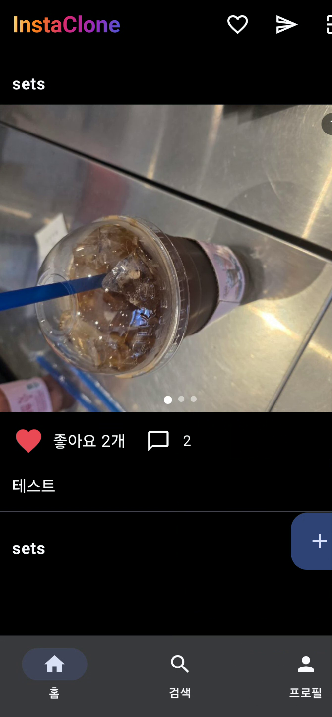
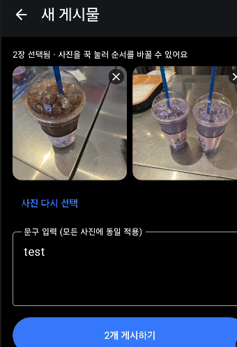
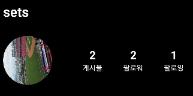

## 한눈에 보기

| 항목 | 내용 |
|---|---|
| 기간 | 2026년 6월 · **완료** |
| 구분 | 모바일프로그래밍 수업 기말 과제 · **개인 활동** |
| 사용 기술 | Kotlin, Jetpack Compose, Firebase Authentication, Cloud Firestore, ImgBB 이미지 업로드 API |
| 결과물 | 안드로이드 앱 (아래 실행 화면) |

## 목표

평소 자주 쓰는 인스타그램의 핵심 기능을 직접 안드로이드 앱으로 만들어 보는 것이 목표였습니다.
로그인한 사용자가 사진을 올리고, 다른 사용자를 팔로우하고, 메시지를 주고받는 흐름이 실제로 동작하게 만드는 데 집중했습니다.

## 내가 한 일

개인 과제로 혼자 진행했습니다. 역할을 정확히 나누면 다음과 같습니다.

- **기획 (본인)**: 어떤 앱을 만들지 정하고, 필요한 기능(게시물·메시지·팔로우·프로필·알림)을 정했습니다.
- **구현 (AI 도구 활용)**: 코드의 대부분은 AI 도구(Claude)에게 기능별로 요청해 작성했습니다.
- **조립과 실행 (본인)**: 받은 코드를 Android Studio 프로젝트에 넣고 Firebase를 연결해 빌드한 뒤, 실제 휴대폰에서 실행하며 동작을 확인했습니다.

## 구현한 기능

| 기능 | 내용 |
|---|---|
| 회원가입·로그인 | Firebase 이메일·비밀번호 인증 |
| 게시물 업로드 | 갤러리에서 사진 여러 장 선택, 길게 눌러 순서 바꾸기, 문구 입력 |
| 피드 | 여러 장 사진 넘겨 보기, 좋아요, 댓글 |
| 메시지 | 1:1 채팅, 사진 메시지, 게시물 공유, 안 읽은 메시지 표시 |
| 팔로우 | 팔로우·언팔로우, 팔로워·팔로잉 목록, 사용자 검색 |
| 프로필 | 프로필 사진·소개 문구 수정, 게시물·팔로워·팔로잉 수 표시 |
| 알림 | 팔로우·좋아요·댓글 알림과 읽음 처리 |

## 진행 과정

### 1. 기본 뼈대부터 시작

처음에는 **로그인 → 피드 보기 → 게시물 작성 → 좋아요**만 되는 기본 형태로 시작했고,
여기에 댓글, 메시지, 팔로우, 알림, 프로필 수정 기능을 하나씩 추가했습니다.

### 2. 사진을 어디에 저장할지 결정

사진 파일을 저장하는 Firebase Storage는 유료 요금제가 필요했습니다.
그래서 처음에는 사진 주소(URL)를 직접 입력하는 방식으로 만들었고,
이후 무료 이미지 호스팅 서비스인 **ImgBB**에 사진을 올리고 돌려받은 주소만 Firestore에 저장하는 방식으로 바꿨습니다.
사진을 올리기 전에 크기를 줄이고, 휴대폰 사진의 회전 정보를 바로잡는 처리도 넣었습니다.

### 3. 사진 한 장에서 여러 장으로

게시물 하나에 사진을 여러 장 올릴 수 있도록 데이터 구조를 바꿨습니다.
예전에 올린 사진 한 장짜리 게시물도 그대로 보이도록 두 형식을 함께 읽게 했습니다.

## 실행 화면

## 배운 점과 남은 문제

**배운 점**

- AI 도구로 코드를 빠르게 만들 수는 있었지만, 오류가 났을 때 원인을 찾으려면 결국 코드가 어떻게 동작하는지 제가 이해하고 있어야 했습니다.
- 앱을 만들 때 기능 코드만큼이나 **요금제, 외부 서비스, 데이터 구조** 같은 선택이 중요하다는 것을 알게 됐습니다.

**남은 문제**

- 이미지 업로드에 쓴 ImgBB API 키를 코드 안에 직접 넣어 두었는데, 현재는 키가 만료되어 **새 사진 업로드가 실패**합니다.
  다음에는 키를 코드 밖(설정 파일)으로 분리하고, 만료됐을 때 사용자에게 알기 쉬운 안내를 보여 주도록 개선하고 싶습니다.
